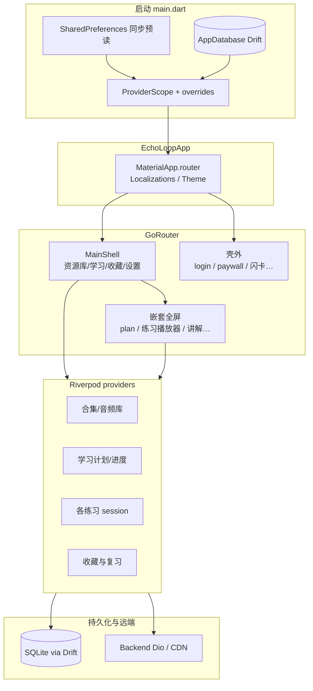
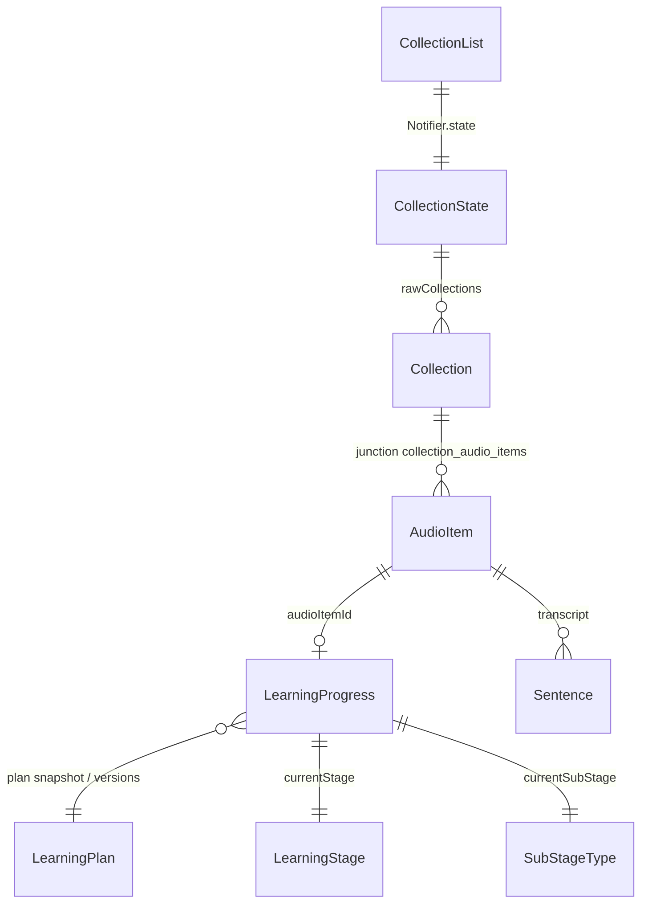
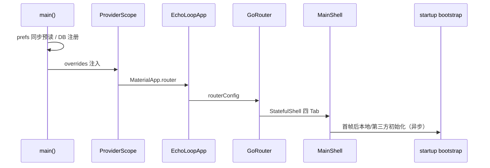

# Code Reading Report: Echo Loop 整体架构

> Produced with the how-to-read-code workflow.  
> 结论标签：**[verified]** = 经运行/测试验证；**[static]** = 仅静态推断。  
> 日期：2026-10-14 · 入口：[学习地图](./README.md)

---

## 1. Scope & purpose

- **Purpose**：理解 Echo Loop **整体架构**（启动、壳/路由、分层、核心域如何拼在一起），不做某一练习页的深度纵向精读。
- **Environment**：
  - 本机有 Flutter SDK；`flutter pub get` 在跑测试前已解析依赖 **[verified]**。
  - 未在本会话启动完整 GUI App（Windows 桌面/模拟器未作为交付条件）。
  - 情景验证（测试即场景文档）：
    - `flutter test test/providers/collection_provider_test.dart` → **25 项通过** **[verified]**（`CollectionState` / `CollectionList`）
    - `flutter test test/router/app_router_test.dart` → **25 项通过** **[verified]**（路径常量、壳内发现页、嵌套子路由防塌栈 §7.17）
  - 未在本会话用调试器对完整 `main→首帧` 抓栈；启动序列仍以源码为准并标部分 **[static]**。
- **Out of scope**：盲听/精听/跟读/复述内部引擎细节、TTS/ASR native、订阅支付实现、词典选区三层化实现、后端服务端。

---

## 2. Architecture overview (horizontal pass)

Echo Loop 是 **Flutter 多端英语听说训练 App**：材料（音频/视频）→ 字幕 → 学习计划驱动的练习阶段 → 收藏与间隔复习；AI/订阅增强但不阻断主闭环（见 `PLAN.md`）**[static]**。

### 顶层组件职责

| 层 | 位置 | 职责 |
|----|------|------|
| 启动 | `lib/main.dart` | Binding、prefs 同步预读、Drift DB 注册、`ProviderScope` + overrides、`MaterialApp.router` |
| 状态仓库 | `ProviderScope` | 全 App Riverpod 容器；UI 用 `ref.watch` / `ref.read` |
| 路由壳 | `lib/router/` | GoRouter；`StatefulShellRoute` 四 Tab；练习页多为嵌套子路由 |
| 页面组装 | `lib/screens/` + `lib/features/*/screens` | Screen 组装；Feature 自管登录/播客/订阅等 |
| 状态与编排 | `lib/providers/` | Notifier / 流程引擎连接 UI 与服务 |
| 数据 | `lib/database/` + `lib/models/` | Drift 持久化；Model 为领域对象 |
| 服务 | `lib/services/` | 网络、TTS、ASR、媒体会话、下载等可注入副作用 |
| Feature 包 | `lib/features/` | 相对独立子域（auth、podcast、subscription、chatbot、memory_scheduler…） |

数据流约定（项目规范）**[static]**：

```text
UI 触发 → Provider/Notifier 改 state → UI 按 state 渲染
副作用走 service/repository，不散落在 Widget
```



### 壳内四 Tab 与主业务路径（横览）

路由路径与嵌套防塌栈由 `app_router_test` **[verified]**；产品动线描述 **[static]**。

```text
资源库 → 合集详情 → 学习计划 → 盲听/精听/跟读/复述（嵌套路由）
学习 Tab → 推荐/待办 → 同上
收藏 → 句/词复习、闪卡
设置 → 能力子页（Navigator.push 居多）+ Feature 账号/订阅
```

详见 [screens.md](./screens.md)。

---

## 3. Core data structures & relationships

架构骨架由「材料 → 进度 → 练习运行态 → 收藏调度」几类结构撑起（字段手册见 [business-models.md](./business-models.md)）**[static]**；合集状态经测试验证 **[verified]**。

| Structure | Defined in | Created / held by | Mutated in | Role |
|-----------|------------|-------------------|------------|------|
| `Collection` | `lib/models/collection.dart` | 用户创建 / 播客·社区导入 | `CollectionList` + DAO | 合集实体 |
| `CollectionState` | `collection_provider.dart` | `CollectionList.build` | `state = copyWith…` | 合集列表 UI 真相源（Riverpod） |
| `AudioItem` | `lib/models/audio_item.dart` | 导入/同步 | audio library providers + DAO | 可学媒体 |
| `Sentence` | `lib/models/sentence.dart` | 字幕加载 | 播放/收藏相关 provider | 句级时间轴文本 |
| `LearningPlan` | `lib/models/learning_plan.dart` | 按 plan 版本工厂 | 只读值对象为主 | 「某大阶段含哪些子步骤」 |
| `LearningProgress` | `lib/models/learning_progress.dart` | 按 audioId | learning progress provider + DAO | 阶段指针、断点、跳过 |
| `LearningStage` / `SubStageType` | `lib/database/enums.dart` | 进度字段使用 | 进度流转 | 大阶段 / 子步骤枚举 |



**寿命**：**[static]** App 级列表/进度多用 `@Riverpod(keepAlive: true)`；单次练习会话可用 autoDispose（按业务配置）。合集：`CollectionList` 为 keepAlive **[static]**（源码注解）。

---

## 4. Vertical analysis（浅）：冷启动 → 可导航壳

整体架构目的下只做**浅纵向**，建立「房子怎么立起来」的心智；不深入练习引擎。



伪路径 **[static]**：

```text
main()
  → SharedPreferences / PackageInfo / Analytics 等
  → AppDatabase(...) + initAppDatabase
  → runApp(PostHogWidget(ProviderScope(... EchoLoopApp)))
  → MaterialApp.router(locale, delegates, routerConfig)
  → GoRouter → MainShell | 壳外路由
  → MainShell 触发 startupBootstrap（本地数据 / 第三方，失败可降级首页）
```

**情景验证（状态层，非完整启动）** **[verified]**：

```text
flutter test test/providers/collection_provider_test.dart
→ All tests passed! (25)
覆盖：排序解析、setSortType、rename/updatedAt、
      CollectionState 排序与 audioIdsMap、播客退订清理等
```

说明：Riverpod「Notifier + State + Provider」与 Drift 合集写入链路在测试中可跑通；完整 `main→首帧` 未在本会话用调试器抓栈。

---

## 5. Black boxes (consciously not opened)

| Interface | Input | Output / Effect | Why not opened |
|-----------|--------|-----------------|----------------|
| 各 `*_player_screen` + flow engine | audioId / 偏好 | 练习会话、进度推进 | 属学习闭环纵深，非本次整体架构 |
| Media engine / 锁屏会话 | 播放意图 | 系统媒体控件 | ADR 深水区（CLAUDE §7.12 等） |
| TTS / ASR 引擎 | 文本/音频 | 合成文件 / 识别文本 | 平台与模型下载子域 |
| `SentenceAiApiClient` 等 | HTTP + NDJSON | 译/析/意群流 | 见 core-services / backend-api |
| RevenueCat / Paddle 权益 | 购买/刷新 | entitlements | Milestone 5 支付子域 |
| `memory_scheduler` | 复习事件 | 到期调度 | 独立基础设施 plan |
| GuideFlow / 词典选区 | 引导/选词 | UI 叠加层 | 支线体验，不挡架构图 |

---

## 6. Design commentary & open questions (Phase 8)

- **为何 Screen + Provider + Drift 三分**：符合单向数据流；合集用 `CollectionState` 不可变快照 + `state =` 通知，便于测试（已由 collection 测试证明）**[verified]**。
- **为何 GoRouter 嵌套子路由**：避免 Android 重建后返回塌栈（CLAUDE §7.17）**[static]**——架构上「URL 表达完整栈」比顶层拍平更稳。
- **为何 Feature 分包 + 顶层 screens 并存**：主闭环页集中在 `lib/screens`，登录/播客/订阅等边界能力进 `features/`，降低主路径噪音 **[static]**。
- **若我来设计会不同的一点**：启动期同步预读项已经很多（locale、TTS、各练习 prefs…）；长期可考虑「首帧最小集 + 明确 hydrate 阶段」，降低 `main()` 认知负担——但当前选择优先消灭首帧闪烁，是合理权衡 **[static]**。
- **可疑/注意**：`player_screen.dart` 遗留未挂路由（screens 文档已记）；读播放路径时勿默认改它 **[static]**。

---

## 7. Follow-ups

- [ ] 用 how-to-read-code **纵深**：学习计划 → 打开盲听（主线精读 flow engine）
- [ ] 跑通 GUI 一次：`flutter run` 某平台，对照启动日志验证 bootstrap **[verified]** 升级
- [x] 跑 `test/router/app_router_test.dart`（本会话 25 项通过）
- [ ] 打开黑盒之一：媒体引擎分离 或 统一 TTS 渲染主干

---

## 维护

- 架构大改（壳 Tab、启动分层、持久化边界）时更新本报告图表。
- 日常学某模块请另开「单机制」读码报告，勿把本文件胀成百科。
