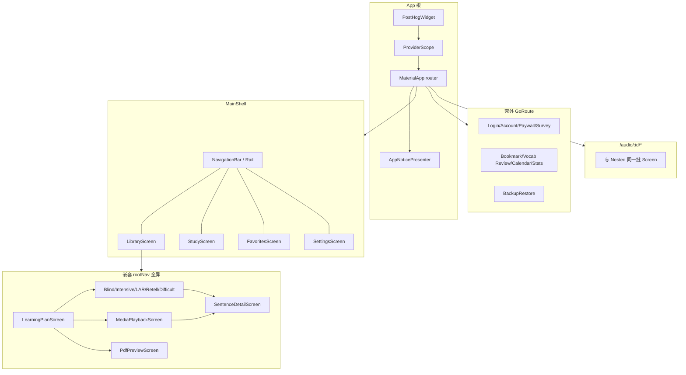

# Echo Loop UI 组件树（全量）

> 按**运行时挂载 / 路由挂载**穷尽梳理：App 根、GoRouter 全路径、四 Tab 页内组装、壳外页、`lib/widgets` 全文件域、叠层与 Modal。  
> 页面业务职责摘要见 [screens.md](./screens.md)；框架控件用法见 [flutter-widgets.md](./flutter-widgets.md)。  
> **匹配规则 / AppRoutes / redirect 速查**见 [app-router.md](./app-router.md)。  
> 源码为准（`lib/router/app_router.dart` 等）。最后更新：2026-10-16 · 入口：[学习地图](./README.md)

**章节导航**

| 节 | 内容 |
|----|------|
| §1 | App 根 |
| §2 | GoRouter **全部**路径（壳四 branch + 壳外 + `/audio`） |
| §3 | MainShell |
| §4 | 四 Tab **页内**组装 |
| §5 | 学习全屏典型内部树 |
| §6–§7 | Feature 页、Chatbot/选区/引导 |
| §8 | `lib/screens` **逐文件** |
| §9 | `lib/widgets` **逐文件** |
| §10 | Modal 域总表 |
| §11 | Mermaid 鸟瞰 |

---

## 0. 读法与图例

| 标记 | 含义 |
|------|------|
| `〔GoRouter〕` | 路由 `builder` 挂上的页面 |
| `〔rootNav〕` | `parentNavigatorKey: rootNavigatorKey`，全屏盖住壳（无底栏） |
| `〔shell〕` | 留在 `StatefulShellBranch` 内，底栏/侧栏仍可见 |
| `〔Navigator.push〕` | `MaterialPageRoute` 等，不在 GoRouter 树 |
| `〔Modal〕` | `showDialog` / `showModalBottomSheet` / 自定义 sheet |
| `〔Stack〕` | 同页叠层 |
| `†` | 遗留或仅 redirect，无独立业务 UI |

**三层心智**：① App 根包装 → ② 路由树（壳内 / 壳外 / 独立 `/audio`）→ ③ 页面内 Widget + Modal。

---

## 1. App 根树（每次启动）

关系要点（先看这三句，再看树）：

1. **`MaterialApp.router` 不自己摆页面**，把导航交给 `routerConfig` 里的 **GoRouter**。  
2. **GoRouter.routes** 是**同一层列表**：一条 `StatefulShellRoute`（主壳 + 四 Tab）+ 若干**平级**的壳外 `GoRoute`（登录、付费墙、`/audio/...` 等）。  
3. **`builder` 的 `child`** = 当前 URL 匹配结果画出的那棵子树（在壳内时通常是 `MainShell`，盖壳全屏时是对应 Screen）。

```text
runApp
└── PostHogWidget
    └── ProviderScope                              ← 全局 Riverpod；main 里大量 override
        └── EchoLoopApp（ConsumerStatefulWidget）
            └── MaterialApp.router
                ├── theme / darkTheme / themeMode
                ├── locale / supportedLocales / localizationsDelegates
                ├── scaffoldMessengerKey
                ├── builder → AppNoticePresenter
                │              └── child ←── 由 GoRouter「当前匹配」注入
                │                            （壳内页 or 壳外全屏页）
                └── routerConfig ──► GoRouter     ← 包：go_router
                      ├── navigatorKey: rootNavigatorKey   ← 根 Navigator（盖壳全屏用）
                      ├── observers: rootRouteObserver, AnalyticsObserver
                      ├── redirect: 登录 / 问卷 / `/`→`/study` …
                      └── routes[]  同一层级，并列注册（一目了然总表）：
                            │
                            ├── StatefulShellRoute.indexedStack
                            │     ├── builder → MainShell(navigationShell)
                            │     │              ├── 底栏 NavigationBar / 侧栏 NavigationRail
                            │     │              └── navigationShell → 当前 branch 页
                            │     └── branches[]  ← StatefulShellBranch（仅此处有 branch）
                            │           │
                            │           ├── [0] /collections → LibraryScreen 〔shell〕
                            │           │     │
                            │           │     │  ※ 下列缩进 = GoRouter「子路由 / URL 嵌套」，
                            │           │     │    不是 LibraryScreen.build() 里的 child Widget。
                            │           │     │    点入口后换 URL，由对应 Screen 的 builder 画页面；
                            │           │     │    仍属资源库 branch → 底栏还在「资源库」。
                            │           │     │
                            │           │     ├── pdf-preview
                            │           │     │     URL: /collections/pdf-preview
                            │           │     │     → PdfPreviewScreen 〔rootNav〕
                            │           │     ├── discover
                            │           │     │     URL: /collections/discover
                            │           │     │     → DiscoverCommunityCollectionsScreen 〔shell〕
                            │           │     │     └── :remoteId
                            │           │     │           URL: /collections/discover/:remoteId
                            │           │     │           → CommunityCollectionDetailScreen
                            │           │     ├── podcast（subscribe 段）
                            │           │     │     URL: /collections/…/podcast…
                            │           │     │     → PodcastDiscoveryScreen 〔shell〕
                            │           │     │     └── preview → PodcastPreviewScreen
                            │           │     └── :collectionId
                            │           │           URL: /collections/:collectionId
                            │           │           → CollectionDetailScreen 〔shell〕
                            │           │           ├── pdf-preview → PdfPreviewScreen 〔rootNav〕
                            │           │           ├── :audioId/plan → LearningPlanScreen 〔rootNav〕
                            │           │           │     └── pdf-preview → PdfPreviewScreen
                            │           │           ├── :audioId/player → MediaPlaybackScreen 〔rootNav〕
                            │           │           │     └── sentence-detail → SentenceDetailScreen
                            │           │           ├── :audioId/media → MediaPlaybackScreen 〔rootNav〕
                            │           │           │     └── sentence-detail → SentenceDetailScreen
                            │           │           ├── :audioId/blind-listen → BlindListenPlayerScreen
                            │           │           │     └── sentence-detail → SentenceDetailScreen
                            │           │           ├── :audioId/intensive-listen → IntensiveListenPlayerScreen
                            │           │           ├── :audioId/listen-and-repeat → ListenAndRepeatPlayerScreen
                            │           │           ├── :audioId/retell → RetellPlayerScreen
                            │           │           │     └── sentence-detail → SentenceDetailScreen
                            │           │           └── :audioId/review-difficult-practice
                            │           │                 → ReviewDifficultPracticeScreen 〔rootNav〕
                            │           │
                            │           ├── [1] /study → StudyScreen 〔shell〕
                            │           │
                            │           ├── [2] /favorites → FavoritesScreen 〔shell〕
                            │           │     └── sentence-detail → SentenceDetailScreen 〔rootNav〕
                            │           │
                            │           └── [3] /settings → SettingsScreen 〔shell〕
                            │                 （提醒/学习/ASR/TTS/播放/词典/开发者等多为 Navigator.push，见 §4.4）
                            │
                            ├── 壳外 GoRoute（与 Shell 平级，不是 branch；多为 〔rootNav〕）
                            │     ├── /backup-restore → BackupRestoreScreen
                            │     ├── /onboarding/survey → OnboardingSurveyScreen
                            │     ├── /login → LoginScreen
                            │     ├── /email-sign-in → EmailSignInScreen
                            │     ├── /check-email → CheckEmailScreen
                            │     ├── /password-sign-in → PasswordSignInScreen
                            │     ├── /account → AccountScreen
                            │     ├── /paywall → PaywallScreen
                            │     ├── /bookmark-review → BookmarkReviewScreen
                            │     ├── /favorite-vocabulary-review → FavoriteVocabularyReviewScreen
                            │     ├── /activity-calendar → ActivityCalendarScreen
                            │     ├── /review-statistics → ReviewStatisticsScreen
                            │     └── † legacy discover / podcast 路径 → redirect 到壳内新路径
                            │
                            └── 独立 /audio/:audioId/…（不依赖合集；〔rootNav〕全屏；Screen 与合集内嵌套同名）
                                  ├── /audio/:audioId/plan → LearningPlanScreen
                                  │     └── pdf-preview → PdfPreviewScreen
                                  ├── /audio/:audioId/player → MediaPlaybackScreen
                                  │     └── sentence-detail → SentenceDetailScreen
                                  ├── /audio/:audioId/media → MediaPlaybackScreen
                                  │     └── sentence-detail → SentenceDetailScreen
                                  ├── /audio/:audioId/subtitles/edit → SubtitleSimpleEditorScreen
                                  ├── /audio/:audioId/blind-listen → BlindListenPlayerScreen
                                  │     └── sentence-detail → SentenceDetailScreen
                                  ├── /audio/:audioId/intensive-listen → IntensiveListenPlayerScreen
                                  ├── /audio/:audioId/listen-and-repeat → ListenAndRepeatPlayerScreen
                                  ├── /audio/:audioId/retell → RetellPlayerScreen
                                  │     └── sentence-detail → SentenceDetailScreen
                                  └── /audio/:audioId/review-difficult-practice
                                        → ReviewDifficultPracticeScreen
```

| 关系 | 说明 |
|------|------|
| `routerConfig → GoRouter` | App 把「画哪一页」委托给 GoRouter |
| `routes` 里 Shell vs 壳外 | **并列**，不是「壳外挂在 branch 下」 |
| `branches` | **只存在于** `StatefulShellRoute` 内部；四个主 Tab 各一条栈 |
| `parentNavigatorKey: rootNavigatorKey` | 仍可声明在 Shell **子路由**上，但页面压到**根** Navigator，视觉上盖住底栏（练习页） |
| `MaterialApp.builder.child` | 等于 GoRouter 当前产出的那页/那壳，再包进 `AppNoticePresenter` |

`AppNoticePresenter`：`lib/widgets/app_notice_presenter.dart`（通知类 UI 宿主）。

---

## 2. GoRouter 全量路由树

### 2.1 StatefulShellRoute（MainShell）— 四 branch

> `branches` 来自 **go_router** 的 `StatefulShellBranch`，在 `StatefulShellRoute.indexedStack(...)` 的 `branches:` 参数里声明（见 `app_router.dart`）。

```text
GoRouter.routes 中的那一条：
StatefulShellRoute.indexedStack
├── builder(context, state, navigationShell)
│     → MainShell(navigationShell: navigationShell)
│           ├── NavigationBar / NavigationRail  ← 调 navigationShell.goBranch(i)
│           └── 正文：navigationShell         ← 当前选中 branch 的页面栈
└── branches: [
      StatefulShellBranch( /* 0 资源库 */ routes: [ GoRoute(/collections) … ] ),
      StatefulShellBranch( /* 1 学习   */ routes: [ GoRoute(/study) ] ),
      StatefulShellBranch( /* 2 收藏   */ routes: [ GoRoute(/favorites) … ] ),
      StatefulShellBranch( /* 3 设置   */ routes: [ GoRoute(/settings) ] ),
    ]
```

#### Branch 0 — `/collections`〔shell〕

```text
/collections → LibraryScreen 〔shell〕
├── pdf-preview → PdfPreviewScreen 〔rootNav〕
├── discover → DiscoverCommunityCollectionsScreen 〔shell〕
│     └── :remoteId → CommunityCollectionDetailScreen 〔shell〕
├── podcast（subscribe 段）→ PodcastDiscoveryScreen 〔shell〕
│     └── preview → PodcastPreviewScreen 〔shell〕
└── :collectionId → CollectionDetailScreen 〔shell〕
      ├── pdf-preview → PdfPreviewScreen 〔rootNav〕
      ├── :audioId/plan → LearningPlanScreen 〔rootNav〕
      │     └── pdf-preview → PdfPreviewScreen 〔rootNav〕
      ├── :audioId/player → MediaPlaybackScreen（经 _AudioPlayerRoute）〔rootNav〕
      │     └── sentence-detail → SentenceDetailScreen 〔rootNav〕
      ├── :audioId/media（mediaPlayerSegment）→ MediaPlaybackScreen 〔rootNav〕
      │     └── sentence-detail → SentenceDetailScreen 〔rootNav〕
      ├── :audioId/blind-listen → BlindListenPlayerScreen 〔rootNav〕
      │     └── sentence-detail → SentenceDetailScreen 〔rootNav〕
      ├── :audioId/intensive-listen → IntensiveListenPlayerScreen 〔rootNav〕
      ├── :audioId/listen-and-repeat → ListenAndRepeatPlayerScreen 〔rootNav〕
      ├── :audioId/retell → RetellPlayerScreen 〔rootNav〕
      │     └── sentence-detail → SentenceDetailScreen 〔rootNav〕
      └── :audioId/review-difficult-practice → ReviewDifficultPracticeScreen 〔rootNav〕
```

#### Branch 1 — `/study`〔shell〕

```text
/study → StudyScreen 〔shell〕
（无 GoRouter 子路由；跳转 plan/练习走合集或 /audio 路径）
```

#### Branch 2 — `/favorites`〔shell〕

```text
/favorites → FavoritesScreen 〔shell〕
└── sentence-detail → SentenceDetailScreen 〔rootNav〕
```

#### Branch 3 — `/settings`〔shell〕

```text
/settings → SettingsScreen 〔shell〕
（能力子页多为 〔Navigator.push〕，见 §4.4；账号/付费墙/备份走壳外 GoRoute）
```

### 2.2 壳外 / 顶层 GoRoute（与 Shell 平级）

```text
/backup-restore → BackupRestoreScreen
/onboarding/survey → OnboardingSurveyScreen 〔rootNav〕
/login → LoginScreen 〔rootNav〕
/email-sign-in → EmailSignInScreen 〔rootNav〕
/check-email → CheckEmailScreen 〔rootNav〕
/password-sign-in → PasswordSignInScreen 〔rootNav〕
/account → AccountScreen 〔rootNav〕
/paywall → PaywallScreen 〔rootNav〕
/bookmark-review → BookmarkReviewScreen 〔rootNav〕
/favorite-vocabulary-review → FavoriteVocabularyReviewScreen 〔rootNav〕
/activity-calendar → ActivityCalendarScreen 〔rootNav〕
/review-statistics → ReviewStatisticsScreen 〔rootNav〕

† legacy discover / podcast 路径 → redirect 到壳内新路径（无独立 Screen）
```

### 2.3 独立音频路径（不依赖合集 ID）〔rootNav〕

与合集内嵌套练习页**同一批 Screen**，仅 `collectionId: null`：

```text
/audio/:audioId/plan → LearningPlanScreen
│     └── pdf-preview → PdfPreviewScreen
/audio/:audioId/player → MediaPlaybackScreen（_AudioPlayerRoute）
│     └── sentence-detail
/audio/:audioId/media → MediaPlaybackScreen
│     └── sentence-detail
/audio/:audioId/subtitles/edit → SubtitleSimpleEditorScreen
/audio/:audioId/blind-listen → BlindListenPlayerScreen
│     └── sentence-detail
/audio/:audioId/intensive-listen → IntensiveListenPlayerScreen
/audio/:audioId/listen-and-repeat → ListenAndRepeatPlayerScreen
/audio/:audioId/retell → RetellPlayerScreen
│     └── sentence-detail
/audio/:audioId/review-difficult-practice → ReviewDifficultPracticeScreen
```

### 2.4 路由辅助 Widget

| Widget | 作用 |
|--------|------|
| `_RestoredRoutePopper` | extra 丢失时首帧 pop，避免白屏 |
| `_AudioPlayerRoute` | 按 audioId 解析材料后交给 `MediaPlaybackScreen` |

---

## 3. MainShell 组件树

```text
MainShell
├── 〔本地数据未就绪〕StartupSplashScreen
│     （可进 LogViewerScreen 〔Navigator.push〕）
└── 〔就绪〕
      ├── 〔宽屏〕Row
      │     ├── MainShellNavigationRail
      │     └── PrewarmVisibility → navigationShell（当前 Tab 页）
      └── 〔窄屏〕Scaffold
            ├── body: PrewarmVisibility → navigationShell
            └── bottomNavigationBar: NavigationBar（四目的地）
```

壳上还可叠加（由 shell 状态驱动，非路由）：

- 〔Modal〕`AppUpdateDialog`、`NotificationPermissionDialog` 等  
- 生命周期 / 远程配置 / 预热逻辑（无独立可见树）

文件：`lib/router/main_shell.dart`、`lib/router/widgets/main_shell_navigation_rail.dart`、`lib/widgets/startup_splash_screen.dart`、`lib/widgets/common/prewarm_visibility.dart`。

---

## 4. 壳内四 Tab — 页内组装

### 4.1 LibraryScreen（`/collections`）

```text
LibraryScreen
└── GuideFlowSequenceHost
    └── Scaffold
        ├── AppBar
        │     ├── 标题（连点可露出「全部音频」）
        │     └── actions:
        │           ├── 〔合集视图〕CollectionSortButton + GuideTarget(创建) IconButton
        │           └── 〔音频视图〕AudioSortButton + 导入 IconButton
        └── body: IndexedStack
              ├── [0] _CollectionListBody
              │     ├── DiscoverEntryBanner
              │     └── loading | CollectionEmptyState | CollectionListView
              │           （行点击 → CollectionDetailScreen）
              └── [1] AudioListView
                    ├── AudioListTile…
                    └── 导入：showImportAudioSheet 〔Modal〕
                          └── ImportAudioSelectionList / AddAudioDialog 等
```

相关非路由组件：`collection_screen.dart`（合集列表/空态/排序等，被 Library 引用）、`edit_collection_membership_sheet.dart`、`showCreateCollectionDialog`。

**仍在本 branch、显底栏的 Feature 页：**

```text
DiscoverCommunityCollectionsScreen
CommunityCollectionDetailScreen
PodcastDiscoveryScreen
PodcastPreviewScreen
```

**合集详情：**

```text
CollectionDetailScreen
└── Scaffold
      ├── AppBar / 合集信息 / 菜单
      └── 音频列表
            → plan / 随心听 / 练习 / 字幕管理 sheet / PDF…
      〔Modal〕ManageSubtitlesSheet、EditCollectionMembershipSheet、导出等
```

### 4.2 StudyScreen（`/study`）

```text
StudyScreen
└── GuideFlowSequenceHost（含）
    └── Scaffold
          ├── AppBar（连续学习 streak GuideTarget）
          └── body: 可滚动列
                ├── StudyStatsHeader（统计入口 → activity-calendar 等）
                ├── 〔任务区〕_TaskSection
                │     └── _TaskCard / _StudyMaterialCard…
                ├── 〔推荐区〕_RecommendedMaterialCard…
                ├── 〔已完成 / 最近完成〕ExpansionTile 段
                └── _CommunityInviteCard
```

辅助：`lib/widgets/study/*`（`StudyDurationChart`、`MonthlySummaryCard`、`ActivityDayCell`、`DayStageBreakdownSheet`、`LearnedWordFormsSheet`、`StudyActivityDetector`、`LearningProgressIcon`）。

### 4.3 FavoritesScreen（`/favorites`）

```text
FavoritesScreen
└── GuideFlowSequenceHost
    └── Scaffold
          ├── AppBar + 分段（句子 / 词汇…）
          ├── body:
          │     ├── _SentencesView → ListView(_AudioBookmarkGroup → _BookmarkSentenceTile…)
          │     └── 词汇/意群视图（同类 List / Tile）
          └── 〔Stack 浮层〕
                ├── _FloatingSentenceReviewButton → /bookmark-review
                └── _FloatingFlashcardButton → vocabulary review
      〔Modal〕SentenceRecycleBinSheet / VocabularyRecycleBinSheet
      〔GoRouter〕sentence-detail
```

### 4.4 SettingsScreen（`/settings`）

```text
SettingsScreen
└── Scaffold
      └── ListView / 分组 ListTile
            ├── 账号 → context.push(login|account)
            ├── 订阅 → paywall
            ├── 提醒 → ReminderSettingsScreen 〔Navigator.push〕
            ├── 学习 → LearningSettingsScreen 〔Navigator.push〕
            ├── ASR → AsrSettingsScreen 〔Navigator.push〕（平台相关）
            ├── TTS → TtsSettingsScreen 〔Navigator.push〕
            ├── 播放 → PlaybackSettingsScreen 〔Navigator.push〕
            ├── 词典 → DictionarySettingsScreen 〔Navigator.push〕
            ├── 备份 → /backup-restore
            ├── 主题 / 语言 / 其它开关（页内）
            └── 〔开发者区〕
                  ├── AsrTestScreen 〔Navigator.push〕
                  ├── LogViewerScreen 〔Navigator.push〕
                  ├── SubscriptionDebugScreen 〔Navigator.push〕
                  ├── PreferencesViewerScreen 〔Navigator.push〕
                  ├── StorageBrowserScreen 〔Navigator.push〕
                  └── 词典查询对话框、时间机器、版本覆盖、Demo 等（页内 Dialog）
```

---

## 5. 学习全屏页 — 典型内部树

合集路径与 `/audio/...` 共用下列 Screen。

### 5.1 LearningPlanScreen

```text
LearningPlanScreen
└── Scaffold
      ├── AppBar（导出 PDF 等）
      └── 阶段列表 / 自由练习入口
            → 打开各 *PlayerScreen / MediaPlaybackScreen
      〔Modal〕步骤完成 StepCompleteDialog 等
```

### 5.2 MediaPlaybackScreen（随心听）

```text
MediaPlaybackScreen
└── Scaffold / 媒体布局
      ├── 视频或封面：MediaVisualSurface / ManagedMediaVisualSurface
      ├── 字幕列表 / FreePlayerSentencePager
      ├── PlaybackControls、SleepTimer…
      └── 可进 sentence-detail
      〔Modal〕FreePlayCompleteDialog、设置类 sheet
```

### 5.3 段落类练习（盲听 / 复述等）

以盲听为例（其它练习同构度高）：

```text
BlindListenPlayerScreen
└── GuideFlowSequenceHost
    └── ParagraphPracticeScaffold
          ├── AppBar（设置、SentenceChatButton…）
          ├── 媒体区 PracticeMediaPresentationHost
          ├── 段落/句子列表 ParagraphSentenceListCard / MaskedSentenceTile…
          ├── PracticePlaybackFooter / RecordingButton（若需要）
          └── 〔Modal〕
                BlindListenSettingsSheet
                BlindListenBriefingSheet
                BlindListenParagraphSheet
                StepCompleteDialog…
```

| Screen | 典型专用 sheet / 结构 |
|--------|----------------------|
| IntensiveListenPlayerScreen | IntensiveListenSettings/BriefingSheet；句级精听 UI |
| ListenAndRepeatPlayerScreen | ListenAndRepeatSettings/Briefing；RecordingButton；SentenceChatButton |
| RetellPlayerScreen | RetellSettings/Briefing/ReviewSheet；批改展示组件 |
| ReviewDifficultPracticeScreen | DifficultPracticeSettingsSheet；ReviewBriefing/StatusBar 等 |

### 5.4 SentenceDetailScreen（讲解）

```text
SentenceDetailScreen
└── Scaffold
      └── DictionaryPanelHost 〔Stack〕
            ├── 正文：SentenceExplanationView / SelectableSentenceText…
            ├── 关面板屏障（词区豁免）
            ├── 选区操作条
            └── DictionaryPanel
                  ├── SourceSwitcher
                  └── DictionaryResultView
                        ├── LocalDictResultView
                        ├── AiDictResultView / AiMultiWordResultView
                        └── WebDictionaryView
      AppBar 可含 SentenceChatButton → 〔Modal〕Chatbot sheet
```

### 5.5 PdfPreviewScreen / SubtitleSimpleEditorScreen

- `PdfPreviewScreen`：预览/分享导出 PDF  
- `SubtitleSimpleEditorScreen`（Feature）：字幕简易编辑全屏  

### 5.6 复习全屏

```text
BookmarkReviewScreen
└── 闪卡 UI + BookmarkReviewSettingsSheet 〔Modal〕

FavoriteVocabularyReviewScreen
└── 词汇/意群复习 UI + 相关 sheet

ActivityCalendarScreen / ReviewStatisticsScreen
└── study/ 日历与统计组件
```

---

## 6. 壳外 Feature 页

| Screen | 路径/入口 | 树要点 |
|--------|-----------|--------|
| OnboardingSurveyScreen | `/onboarding/survey` | 问卷全屏 |
| LoginScreen | `/login` | 登录入口 |
| EmailSignInScreen | `/email-sign-in` | 邮箱 |
| CheckEmailScreen | `/check-email` | 验邮 |
| PasswordSignInScreen | `/password-sign-in` | 密码 |
| AccountScreen | `/account` | 账号 |
| PaywallScreen | `/paywall` | 付费墙 |
| SubscriptionDebugScreen | 设置开发者 〔Navigator〕 | 订阅调试 |
| DiscoverCommunityCollectionsScreen | 壳内 discover | 社区发现 |
| CommunityCollectionDetailScreen | 壳内 | 社区详情 |
| PodcastDiscoveryScreen / Preview | 壳内 podcast | 播客 |
| ChatScreen / ChatEditScreen | Chatbot sheet / 编辑 | 见 §7 |
| SubtitleSimpleEditorScreen | `/audio/.../subtitles/edit` | 字幕编辑 |

---

## 7. 非路由叠加：Chatbot / 选区 / 引导

### 7.1 Chatbot

```text
SentenceChatButton（挂在练习 AppBar / 讲解 / 可选句组件）
└── showSentenceChatbotSheet 〔Modal〕
      └── Chatbot sheet
            └── ChatView
                  ├── MessageList（含 SelectableAssistantMarkdown）
                  ├── 输入区
                  └── SelectionToolbarHost（AI 回答选区）
```

亦可进入 `ChatScreen` / `ChatEditScreen`（Feature screens）。开关：`kChatbotEnabled` + remote config。

### 7.2 词典面板层序（固定）

```text
DictionaryPanelHost
└── 〔Stack〕
      1. 正文
      2. 〔面板开〕点击关闭屏障（词区 tap-through）
      3. 选区 Toolbar 层
      4. DictionaryPanel
```

无面板页用 `SelectionToolbarHost`。选区内核：`lib/widgets/selection/*`。

### 7.3 新用户引导

```text
GuideFlowSequenceHost
└── child（页面）
      └── GuideTarget(step: …) 锚定高亮
```

`lib/widgets/guide_flow.dart`。

---

## 8. `lib/screens` 全文件对照

| 文件 | 路由/入口 | 备注 |
|------|-----------|------|
| `library_screen.dart` | `/collections` | |
| `collection_screen.dart` | 被 Library 引用 | **非独立路由** |
| `collection_detail_screen.dart` | `:collectionId` | |
| `study_screen.dart` | `/study` | |
| `favorites_screen.dart` | `/favorites` | |
| `settings_screen.dart` | `/settings` | |
| `learning_plan_screen.dart` | `.../plan` 与 `/audio/.../plan` | |
| `media_playback_screen.dart` | player/media 路由 | |
| `blind_listen_player_screen.dart` | blind-listen | |
| `intensive_listen_player_screen.dart` | intensive-listen | |
| `listen_and_repeat_player_screen.dart` | listen-and-repeat | |
| `retell_player_screen.dart` | retell | |
| `review_difficult_practice_screen.dart` | review-difficult-practice | |
| `sentence_detail_screen.dart` | sentence-detail 嵌套 | |
| `pdf_preview_screen.dart` | pdf-preview 嵌套 | |
| `bookmark_review_screen.dart` | `/bookmark-review` | |
| `favorite_vocabulary_review_screen.dart` | favorite-vocabulary-review | |
| `activity_calendar_screen.dart` | `/activity-calendar` | |
| `review_statistics_screen.dart` | review-statistics | |
| `backup_restore_screen.dart` | `/backup-restore` | |
| `reminder_settings_screen.dart` | 〔Navigator〕 | |
| `learning_settings_screen.dart` | 〔Navigator〕 | |
| `playback_settings_screen.dart` | 〔Navigator〕 | |
| `asr_settings_screen.dart` | 〔Navigator〕 | |
| `tts_settings_screen.dart` | 〔Navigator〕 | |
| `dictionary_settings_screen.dart` | 〔Navigator〕 | |
| `log_viewer_screen.dart` | 〔Navigator〕/启动失败入口 | |
| `preferences_viewer_screen.dart` | 〔Navigator〕 | |
| `storage_browser_screen.dart` | 〔Navigator〕 | |
| `asr_test_screen.dart` | 〔Navigator〕 | |
| `player_screen.dart` | **无路由挂载** † | 遗留；主路径用 MediaPlaybackScreen |

---

## 9. `lib/widgets` 全量目录树

路径均相对 `lib/widgets/`。

### 9.1 根级

```text
add_audio_dialog.dart
animated_bookmark_icon.dart
app_notice_presenter.dart
app_update_dialog.dart
asr_download_prompt_dialog.dart
audio_list_tile.dart
audio_list_view.dart
blind_listen_briefing_sheet.dart
blind_listen_paragraph_sheet.dart
blind_listen_settings_sheet.dart
edit_collection_membership_sheet.dart
edit_tag_membership_sheet.dart
guide_flow.dart
import_audio_selection_list.dart
import_audio_sheet.dart
learning_progress_icon.dart
manage_subtitles_sheet.dart
media_type_icon.dart
notification_permission_dialog.dart
playback_controls.dart
player_hotkey_scope.dart
settings_dialog.dart
sleep_timer.dart
speech_permission_dialog.dart
startup_splash_screen.dart
```

### 9.2 `common/`

```text
ai_content_section.dart
anchored_action_bar.dart
anchored_bubble.dart
app_dropdown.dart
app_popup_menu.dart
app_segmented_button.dart
async_toggle_button.dart
audio_app_bar_title.dart
bookmark_toggle_row.dart
briefing_action_row.dart
collection_added_badge.dart
countdown_chip.dart
download_gate_dialog.dart
form_input_style.dart
free_player_sentence_pager.dart
learning_briefing_sheet_content.dart
local_audio_clip_play_button.dart
managed_media_visual_surface.dart
masked_sentence_tile.dart
media_visual_surface.dart
paragraph_practice_scaffold.dart
paragraph_selection_sheet.dart
paragraph_sentence_list_card.dart
paragraph_visibility_controls.dart
pause_choice_dropdown.dart
platform_selection_feedback.dart
platform_text_selection_style.dart
playback_controls.dart
practice_media_presentation_host.dart
practice_playback_footer.dart
prewarm_visibility.dart
processing_indicator.dart
recording_button.dart
repeat_practice_panel.dart
secondary_action_button.dart
setting_labeled_row.dart
settings_section_card.dart
settings_sheet_scaffold.dart
shimmer_placeholder.dart
speech_rating_badge.dart
status_label.dart
tappable_wrapper.dart
text_context_menu.dart
```

### 9.3 `practice/`

```text
practice_normal_mode_view.dart
practice_play_count_label.dart
practice_progress_section.dart
practice_sentence_pager.dart
selectable_sentence_text.dart
sense_group_action_bar.dart
sense_group_text.dart
sentence_annotation_card.dart
sentence_explanation_view.dart
sentence_word_selection.dart
```

### 9.4 `dictionary/`

```text
ai_dict_result_view.dart
ai_multi_word_result_view.dart
dict_source_presentation.dart
dictionary_panel.dart
dictionary_panel_host.dart
dictionary_result_view.dart
local_dict_result_view.dart
pos_tag.dart
pronunciation_controls.dart
source_switcher.dart
web_dictionary_load_state.dart
web_dictionary_view.dart
```

### 9.5 `selection/`

```text
app_selectable_text.dart
multi_paragraph_selection_backend.dart
paragraph_selection_backend.dart
platform_selection_handles.dart
selectable_content.dart
selection_backend.dart
selection_extend.dart
selection_geometry.dart
selection_gesture_detector.dart
selection_highlight.dart
selection_keyboard.dart
selection_magnifier.dart
selection_presentation.dart
selection_toolbar.dart
selection_toolbar_host.dart
selection_toolbar_layer.dart
text_selection_session.dart
unbounded_hit_stack.dart
```

### 9.6 其它子目录

```text
bookmark_review/bookmark_review_settings_sheet.dart
difficult_practice/difficult_practice_settings_sheet.dart
favorites/recycle_bin_sheet_base.dart
favorites/sentence_recycle_bin_sheet.dart
favorites/vocabulary_recycle_bin_sheet.dart
intensive_listen/intensive_listen_briefing_sheet.dart
intensive_listen/intensive_listen_settings_sheet.dart
listen_and_repeat/listen_and_repeat_briefing_sheet.dart
listen_and_repeat/listen_and_repeat_settings_sheet.dart
retell/retell_briefing_sheet.dart
retell/retell_review_corrections.dart
retell/retell_review_key_points.dart
retell/retell_review_rating_style.dart
retell/retell_review_report.dart
retell/retell_review_sheet.dart
retell/retell_review_transcript_card.dart
retell/retell_settings_sheet.dart
review/review_briefing_sheet.dart
review/review_completion_summary.dart
review/review_status_bar.dart
study/activity_day_cell.dart
study/day_stage_breakdown_sheet.dart
study/learned_word_forms_sheet.dart
study/monthly_summary_card.dart
study/study_activity_detector.dart
study/study_duration_chart.dart
study/study_stage_visuals.dart
study/study_stats_header.dart
tts/speak_button.dart
tts/tts_model_download_prompt_dialog.dart
dialogs/completion_dialog_parts.dart
dialogs/confirm_dialog.dart
dialogs/export_audio_dialog.dart
dialogs/free_play_complete_dialog.dart
dialogs/step_complete_dialog.dart
dialogs/text_input_dialog.dart
```

### 9.7 Feature 内 widgets（摘录）

不在 `lib/widgets`，但同样挂进 UI 树：

```text
features/chatbot/widgets/     sentence_chat_button, chat_view, message_*, selectable_assistant_markdown…
features/chatbot/screens/     chat_screen, chat_edit_screen
features/auth/screens/        login, email, check_email, password, account
features/subscription/        paywall_screen, subscription_debug_screen
features/podcast/             discovery/preview screens + widgets
features/community_collections/ discover + detail + banners/widgets
features/onboarding_survey/   onboarding_survey_screen
features/subtitle_editor/     SubtitleSimpleEditorScreen
```

---

## 10. Modal / Dialog 挂载一览（按触发域）

| 域 | 典型 〔Modal〕 |
|----|----------------|
| 全局/壳 | AppUpdateDialog、NotificationPermissionDialog、AppNoticePresenter |
| 资源库 | ImportAudioSheet、创建合集 Dialog、EditCollectionMembershipSheet |
| 合集/材料 | ManageSubtitlesSheet、ExportAudioDialog、EditTagMembershipSheet |
| 练习通用 | StepCompleteDialog、LearningBriefingSheetContent、SettingsSheetScaffold |
| 盲听 | BlindListenSettings/Briefing/ParagraphSheet |
| 精听 | IntensiveListenSettings/BriefingSheet |
| 跟读 | ListenAndRepeatSettings/BriefingSheet、SpeechPermission、AsrDownloadPrompt |
| 复述 | RetellSettings/Briefing/ReviewSheet |
| 难句复习 | DifficultPracticeSettings、ReviewBriefing |
| 词典/TTS | TtsModelDownloadPrompt、词典设置页内控件 |
| 收藏 | RecycleBin sheets、BookmarkReviewSettingsSheet |
| 句聊 | Chatbot sheet |
| 学习统计 | DayStageBreakdownSheet、LearnedWordFormsSheet |

---

## 11. 鸟瞰总图



---

## 12. 与其它文档

| 文档 | 侧重 |
|------|------|
| **本文** | 挂载关系穷尽 + widgets 全目录 |
| [screens.md](./screens.md) | 页面职责与用户路径（可略简） |
| [flutter-widgets.md](./flutter-widgets.md) | Flutter 框架控件手册 |
| [architecture-reading-report.md](./architecture-reading-report.md) | 架构与数据，非 UI 树 |

---

## 维护

- 增删 **GoRoute / Screen / widgets 目录文件** 时更新对应 §2 / §8 / §9。  
- 仅改某页内部布局且不新增对外组件文件：可只改该页 §4/§5 小节。  
- `player_screen.dart` 若重新挂路由，更新 §8 备注。
